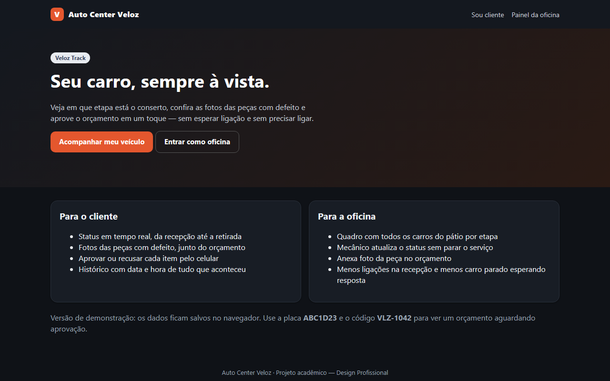
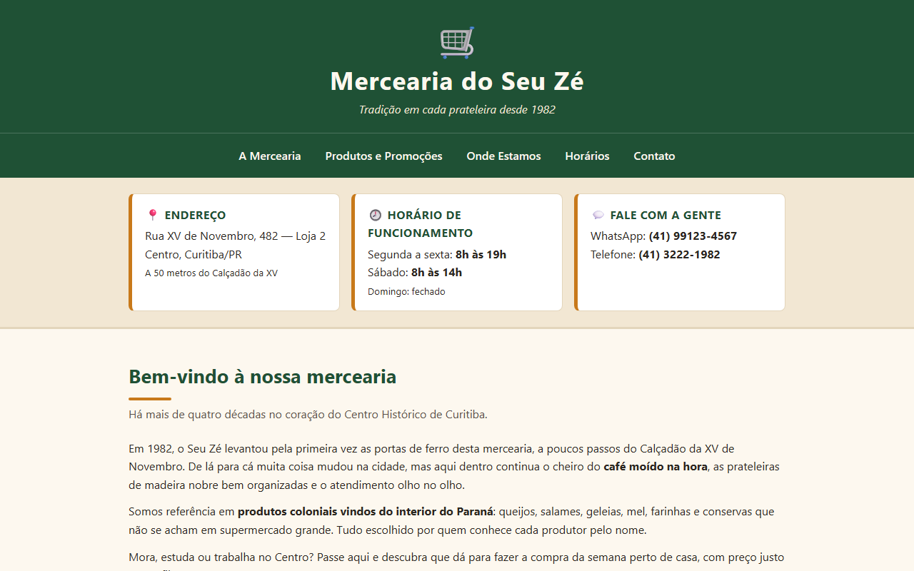

  

  
  
  

## Sobre mim

Sou estudante de **Análise e Desenvolvimento de Sistemas** na Universidade Positivo (conclusão prevista para 2027) e trabalho como assistente de contratos na área de monitoramento eletrônico. No dia a dia lido com sistemas de chamados, consulta de equipamentos e controles em planilhas, e é dessa rotina que vêm muitas das ideias que transformo em código: ferramentas que economizam tempo e deixam processos mais claros.

Busco minha primeira oportunidade em **desenvolvimento de sistemas** para unir o que aprendo no curso à visão de quem conhece a operação por dentro.

- Desenvolvo projetos web com **HTML, CSS e JavaScript**, publicados no GitHub Pages
- Crio fluxos de automação com **n8n**, integrando WhatsApp, Google Sheets e e-mail
- Estudando agora: **SQL (MySQL)**, **linguagem C** e **Git/GitHub**

## Tecnologias

| Área | Ferramentas |
| :-- | :-- |
| **Desenvolvimento** |      |
| **Automação** |    |
| **Em estudo** |     |
| **Outras ferramentas** |     |

## Projetos em destaque

<table>
  <tr>
    <td width="50%" valign="top">
      
      <h3>Veloz Track · Auto Center Veloz</h3>
      
Web app para oficina mecânica: o cliente acompanha o conserto pelo celular, vê as fotos das peças e aprova cada item do orçamento com um toque. A oficina atualiza o status por um painel, sem precisar ligar para ninguém.

      

        
        
        
      

      
<a href="https://rennanjackowski.github.io/autocenter-veloz/"><b>Ver demo</b></a> &nbsp;·&nbsp; <a href="https://github.com/rennanjackowski/autocenter-veloz">Código</a>

    </td>
    <td width="50%" valign="top">
      
      <h3>Mercearia do Seu Zé</h3>
      
Landing page para uma mercearia tradicional do Centro de Curitiba, pensada para ser encontrada no Google: HTML5 semântico, dados estruturados schema.org e layout mobile first. Feito em dupla com <a href="https://github.com/paulogeandre">@paulogeandre</a>.

      

        
        
        
      

      
<a href="https://rennanjackowski.github.io/desafio-mercearia-seu-ze/"><b>Ver site</b></a> &nbsp;·&nbsp; <a href="https://github.com/rennanjackowski/desafio-mercearia-seu-ze">Código</a>

    </td>
  </tr>
</table>

## Outros projetos

- **Painel de relatório semanal** · JavaScript  
  Ferramenta interna que reúne em planilha os tickets tratados na semana, com filtros, e gera um relatório em PDF padronizado entregue aos gestores toda sexta-feira. *Código não público, de uso interno.*
- **Automação de controle de gastos** · n8n, WhatsApp e Google Sheets  
  O usuário envia o gasto pelo WhatsApp, em texto, áudio ou imagem, e o fluxo registra os dados e a forma de pagamento (cartão, dinheiro ou Pix) em uma planilha, com confirmação por e-mail. *Projeto acadêmico.*

## Formação

| Curso | Instituição | Período |
| :-- | :-- | :-- |
| Tecnologia em Análise e Desenvolvimento de Sistemas | Universidade Positivo | Cursando · previsão 2027 |
| Técnico em Desenho Industrial | SENAI Joaçaba (SC) | 2023 – 2024 |

**Idiomas:** português nativo · inglês básico a intermediário, com leitura técnica

## Contato

Estou aberto a conversar sobre oportunidades de estágio e vagas júnior em desenvolvimento. O melhor caminho é o e-mail **[rennanjkw2019@gmail.com](mailto:rennanjkw2019@gmail.com)**.
